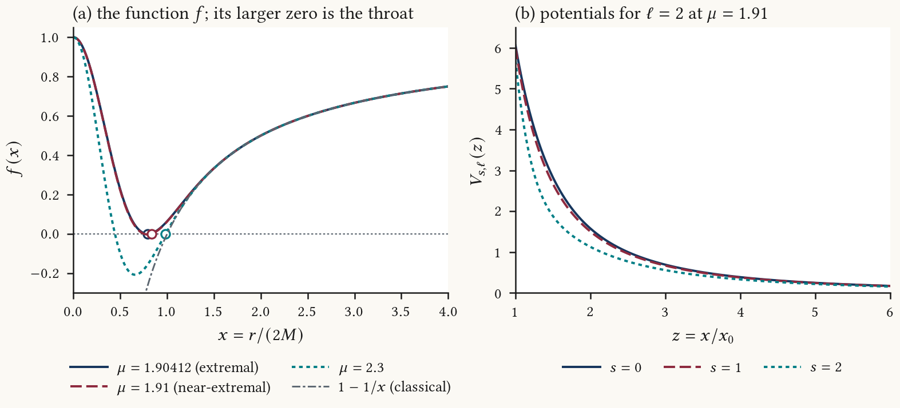

<!-- Author: Dr. Denys Dutykh (Mathematics Department, Khalifa University of Science and Technology, Abu Dhabi, UAE) -->

# ncwh: quasinormal modes of noncommutative geometry-inspired wormholes



Panel (a) shows the function f(x) = 1 − erf(μx)/x + (2μ/√π) e^(−μ²x²), whose larger zero is the throat x0 of the
wormhole (circles): at the extremal mass μ_e = 1.904119 its two zeros merge at x_e = 0.793658; at μ = 1.91, the
near-extremal case of the article, x0 = 0.830987; at μ = 2.3, x0 = 0.983286. Far from the throat f joins 1 − 1/x, the
function of the classical Schwarzschild wormhole, whose throat is at x = 1. Panel (b) shows, against z = x/x0, the
potentials of the scalar (s = 0), electromagnetic (s = 1) and vector-type gravitational (s = 2) perturbations with ℓ = 2
at μ = 1.91: they are largest at the throat and decay like ℓ(ℓ + 1)/z².

ncwh holds the Maple and MATLAB material of a study of the quasinormal modes of the wormhole inspired by noncommutative
geometry, whose spatial geometry is that of the noncommutative Schwarzschild black hole (a point mass smeared into a
Gaussian of width √θ), and of the classical Schwarzschild wormhole, its limit when the rescaled mass μ = M/√θ is large.
It computes the frequencies at which massless scalar (s = 0), electromagnetic (s = 1) and vector-type gravitational
(s = 2) perturbations ring and decay outside the throat, under two different boundary conditions at the throat. Maple
procedures assemble, in multiprecision arithmetic, the Chebyshev collocation of the compactified radial equation, and a
MATLAB driver solves the resulting quadratic eigenvalue problem with the Advanpix Multiprecision Computing Toolbox and
draws the spectra of three resolutions on one picture. The method and the results are those of the article by Davide
Batic, Denys Dutykh and Joudy Jamal Beek in Classical and Quantum Gravity (2025), cited below.

## The problem

The wormhole has no redshift function, and in the rescaled radius x = r/(2M) its line element is
ds² = −dt² + dr²/f + r² dΩ², with

```text
f(x) = 1 − erf(μx)/x + (2μ/√π) e^(−μ²x²),       μ = M/√θ,
```

θ being the noncommutativity parameter (an area). For μ < μ_e = 1.904119076 the function f has no zero and there is no
throat; at μ_e its two zeros merge at x_e = 0.7936575898, a degenerate configuration that is not a traversable
wormhole; for μ > μ_e the throat is the larger zero x0, which tends to 1 as μ grows. With the time dependence
e^(−iωt) and spherical harmonics of degree ℓ ⩾ s, each perturbation obeys, outside the throat,

```text
√f d/dr( √f dψ/dr ) + [ ω² − U(r) ] ψ = 0,       U(r) = ℓ(ℓ + 1)/r² + (1 − s)(1 + 2s) f′(r)/(2r),
```

with the dimensionless frequency Ω = 2Mω, and Im Ω < 0 for a damped mode. In the variable z = x/x0 > 1 the throat is
z = 1, a regular singular point, where the two exponents of Frobenius give two sets of boundary conditions: the field
finite at the throat (Case A of the article for the noncommutative wormhole, Case I for the classical one), or the
field vanishing there like √(1 − 1/z) (Cases B and II). At infinity the field is outgoing. Both behaviours are built
into a factorisation of the solution, the map z = 2/(1 − y) sends the throat to y = −1 and infinity to y = +1, and the
regular part is expanded in n Chebyshev polynomials collocated at the n roots y_i = cos((2i − 1)π/(2n)). The frequency
enters the collocated equation at most quadratically, which gives

```text
( M0 + i Ω M1 + Ω² M2 ) a = 0
```

with three real n × n matrices; Maple exports `M1` without the factor i, which the driver applies when it solves the
problem as `polyeig(M0, mp('1i')*M1, M2)`. The derivations and the limits of the coefficients at y = ±1 are in the
article and in the worksheets.

## Quick start

Each procedure writes its matrices into the folder `data/` of the path it is given, which must exist. In a terminal:

```bash
git clone https://github.com/dutykh/ncwh.git
cd ncwh
mkdir -p data
```

In Maple, read the procedure of the case and call it once per resolution; here the noncommutative wormhole with the
first boundary condition (Case A), a scalar perturbation with ℓ = 2 and the near-extremal mass μ = 1.91 of the article:

```maple
read "matrixassembler_bc1.mpl":
MatrixAssembler(200, 200, 0, 2, 1.91, "/absolute/path/to/ncwh"):
MatrixAssembler(200, 150, 0, 2, 1.91, "/absolute/path/to/ncwh"):
MatrixAssembler(200, 100, 0, 2, 1.91, "/absolute/path/to/ncwh"):
```

The arguments are the number of digits `d`, the number of Chebyshev modes `n` (the size of the matrices), the spin `s`,
the multipole `L` (that is ℓ), the rescaled mass `mu` and the path `p`. The procedure stops if ℓ < s, finds and prints
the throat x0 (by `fsolve` from x = 0.99, which needs μ > μ_e) and writes `data/M0_n.mat`, `data/M1_n.mat` and
`data/M2_n.mat` in the ASCII format of MATLAB. For the classical Schwarzschild wormhole the mass is not an argument and
no root is sought, since its coefficients are polynomials in y:

```maple
read "matrixassembler_sbc1.mpl":
MatrixAssembler(200, 200, 0, 2, "/absolute/path/to/ncwh"):
```

All four procedures write files of the same names, so each case is assembled and solved before the next one, or in a
folder of its own. Then, in MATLAB, make the line `addpath('/path/to/advanpix/')` of `chaseQNMs.m` point to the
Advanpix toolbox, check that its list of resolutions `list = [200, 150, 100]` matches the assembled ones, and run, from
the folder of the repository:

```matlab
chaseQNMs
```

For each resolution n the script sets the precision to n digits (`mp.Digits(n)`), reads the three matrices with
`mp.read`, solves the eigenvalue problem and draws all the spectra in the plane of Re ω and Im ω, one marker per
resolution; it stops with an error if its list of markers is shorter than `list`. The quasinormal frequencies are the
eigenvalues that stay in place from one resolution to the next; the others are artefacts of the truncation. The number
of digits `d` given to Maple must be at least the largest precision that MATLAB requests (200 with the default list).
The article overlaps n = 100, 150 and 200 and reports values computed with 200 digits.

Two checks of the article are reproduced with these files. For a large mass (μ = 10³ in the article) the frequencies of
`matrixassembler_bc1.mpl` approach those of `matrixassembler_sbc1.mpl`, and those of `matrixassembler_bc2.mpl` those of
`matrixassembler_sbc2.mpl`: the noncommutative wormhole tends to the classical one. And the two boundary conditions give
two different spectra of the same wormhole; for the classical one the article finds Case II more damped than Case I.

## Contents

| File | Content |
|---|---|
| `01-NONEXTREME CASE_NCWH_BC1-SUPPLEMENTAL MATERIAL.mw` | Maple 18 worksheet: the derivation for the noncommutative wormhole with the field finite at the throat (Case A): the ansatz, the transformed equation, the zeros and poles of its coefficients at y = ±1, the coefficients `L00hat` to `L22hat` and their limits |
| `01-NONEXTREME CASE_NCWH_BC2-SUPPLEMENTAL MATERIAL.mw` | the same with the field vanishing at the throat (Case B) |
| `01-FROM THROAT_SCHWARZSCHILD WORMHOLE SUPPL MATERIAL.mw` | the derivation for the classical Schwarzschild wormhole, Case I, with the coefficients `L00` to `L22` |
| `02-FROM THROAT_SCHWARZSCHILD WORMHOLE SUPPL MATERIAL.mw` | the same, Case II, with the extra factor √(1 − 1/x) |
| `matrixassembler_bc1.mpl`, `matrixassembler_bc2.mpl` | the Maple procedures for the noncommutative wormhole, Cases A and B: `MatrixAssembler(d, n, s, L, mu, p)` |
| `matrixassembler_sbc1.mpl`, `matrixassembler_sbc2.mpl` | the Maple procedures for the classical Schwarzschild wormhole, Cases I and II: `MatrixAssembler(d, n, s, L, p)` |
| `chaseQNMs.m` | the MATLAB driver |
| `docs/figures/` | the script `plot_readme_figure.py` that draws the figure of this page from f and from the potential, with the style file beside it |

The coefficients defined at the end of each worksheet are those that the corresponding procedure evaluates at the
collocation points. Only the non-extremal case is treated, as the names of the files say.

## Requirements

Maple 18 or later, in which the worksheets are saved; the procedures use only `LinearAlgebra`, `ChebyshevT`, `fsolve`
and `ExportMatrix`. MATLAB with the Advanpix Multiprecision Computing Toolbox (a commercial toolbox), whose `mp` class,
`mp.Digits`, `mp.read` and multiprecision `polyeig` the driver uses: the eigenvalue problems of this size are not
resolved in double precision. The figure of this page needs Python 3 with NumPy, SciPy and Matplotlib, and is redrawn
from `docs/figures/` by `python3 plot_readme_figure.py`.

## How to cite

If you use this code, please cite the article:

D. Batic, D. Dutykh and J. Jamal Beek, A spectral approach for quasinormal frequencies of noncommutative
geometry-inspired wormholes, Classical and Quantum Gravity 42, 085003 (2025).

https://doi.org/10.1088/1361-6382/adc2c6

```bibtex
@article{Batic2025a,
  author = {Batic, Davide and Dutykh, Denys and Jamal Beek, Joudy},
  title = {A Spectral Approach for Quasinormal Frequencies of Noncommutative Geometry-Inspired Wormholes},
  journal = {Classical and Quantum Gravity},
  year = 2025,
  month = apr,
  volume = {42},
  number = {8},
  pages = {085003},
  doi = {10.1088/1361-6382/adc2c6},
  eprint = {2504.02370},
  archiveprefix = {arXiv}
}
```

The button "Cite this repository" in the right-hand column of this page gives the same reference, read from
`CITATION.cff`. A free copy of the article is on arXiv:

https://arxiv.org/abs/2504.02370

## Licence

GNU Lesser General Public License, version 2.1 (see `LICENSE`).

## Authors

Davide Batic and Denys Dutykh (Mathematics Department, Khalifa University of Science and Technology, Abu Dhabi) and
Joudy Jamal Beek (Physics Department, Khalifa University of Science and Technology, Abu Dhabi). The article is listed,
with the other studies of quasinormal modes of the same group, in the
[Quasi-Normal Modes Hall of Fame](https://qnms.denys-dutykh.com/).

https://www.denys-dutykh.com/
